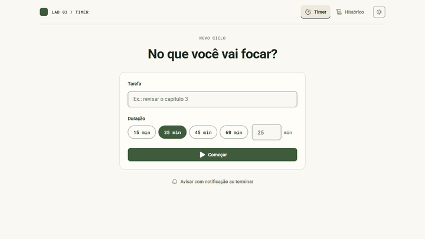

<p align="center">
  <a href="https://will-ifes.github.io/ignite-timer/">
    
  </a>
</p>

# Ignite Timer · ciclos de foco

Timer no estilo Pomodoro: escolha uma tarefa e uma duração, foque até o anel fechar e acompanhe o histórico. Começou no Ignite da Rocketseat para estudar formulários, Context API, `useReducer` e rotas, e foi refeito em 2026 com stack atual, testes e a linguagem visual do [Will Labs](https://github.com/Will-Ifes/will-labs).

**React 19 · TypeScript · React Router 8 · React Hook Form + Zod 4 · Vitest** · [Ver online](https://will-ifes.github.io/ignite-timer/)

<p align="center">
  <a href="https://will-ifes.github.io/ignite-timer/">
    
  </a>
  <br />
  <sub>Clique na demonstração para abrir o timer publicado.</sub>
</p>

## O que dá para fazer

- **Começar um ciclo** com tarefa e duração de 1 a 60 minutos, por presets (15, 25, 45 e 60) ou digitando.
- **Pausar e retomar** sem perder tempo: o tempo pausado não conta como foco.
- **Ser avisado no fim** com bipe (Web Audio, sem arquivo de som), notificação do sistema se você permitir, e mensagem na tela.
- **Acompanhar na aba do navegador**: o título mostra o tempo restante e volta ao normal quando o ciclo termina.
- **Ver o histórico** com foco de hoje, concluídos, interrompidos e taxa de conclusão; filtrar por status; apagar ciclos.
- **Reaproveitar tarefas**: o campo sugere as tarefas que você já usou.

Tudo fica salvo no navegador, inclusive o ciclo em andamento: fechar e abrir a aba continua a contagem.

## O que mudou na revisão

| Antes | Depois |
| --- | --- |
| **Quebrava na primeira visita**: o inicializador do `useReducer` devolvia `undefined` quando não havia nada salvo | Estado inicial garantido, leitura tolerante a JSON inválido e migração do formato antigo |
| Mensagem "no mínimo 5 minutos" com validação de 1 minuto, e o limite de 60 comentado no campo | Zod 4 com regras e mensagens coerentes (1 a 60, inteiro) e erros ligados ao campo |
| Título da aba ficava preso no último tempo depois do fim | Título volta ao normal ao concluir ou interromper |
| Fim do ciclo silencioso | Som, notificação opcional e aviso na tela |
| Sem pausa | Pausar e retomar, com o tempo pausado descontado |
| `/history` dava 404 ao recarregar no GitHub Pages | `HashRouter`, que funciona em hospedagem estática |
| Sugestões fixas "Projeto 1, 2, 3" | Sugestões vindas do histórico |
| Action do reducer tipada como `any`, `immer`, `date-fns` e styled-components | Reducer puro com ações tipadas, `Intl` para datas e CSS com tokens do Will Labs |
| React 18, Vite 3, TypeScript 4 e `phosphor-react` (descontinuado) | React 19, Vite 8, TypeScript 6, React Router 8 e `@phosphor-icons/react`; 0 vulnerabilidades |
| Sem testes | 13 testes: domínio (pausa, estatísticas, migração) e fluxo completo com relógio simulado |

**Validação:** axe-core sem violações no timer ativo, no formulário com erro e no histórico, nos temas claro e escuro, em 375 e 1366 px.

## Por dentro do código

| Código | Responsabilidade |
| --- | --- |
| [`src/domain/ciclos.ts`](src/domain/ciclos.ts) | Regras puras: reducer, tempo efetivo com pausas, estatísticas, sugestões e migração. |
| [`src/contexts/CiclosContext.tsx`](src/contexts/CiclosContext.tsx) | Estado global com persistência. |
| [`src/hooks/useRelogio.ts`](src/hooks/useRelogio.ts) | Contagem a partir do relógio do sistema (sem acumular atraso), conclusão e título da aba. |
| [`src/pages/Timer`](src/pages/Timer) | Formulário com React Hook Form + Zod, anel de progresso em SVG e controles. |
| [`src/pages/Historico`](src/pages/Historico) | Estatísticas, filtro e tabela. |

## Executar localmente

Requer Node.js 20.19 ou superior.

```bash
git clone https://github.com/Will-Ifes/ignite-timer.git
cd ignite-timer
npm install
npm run dev
```

| Comando | O que faz |
| --- | --- |
| `npm run dev` | Servidor de desenvolvimento |
| `npm test` | Testes com Vitest |
| `npm run lint` | ESLint |
| `npm run build` | Typecheck e build de produção |

---

Mantido por **Will Oliveira** · [Perfil](https://github.com/Will-Ifes) · [LinkedIn](https://www.linkedin.com/in/wildemberg-de-jesus-oliveira/)
